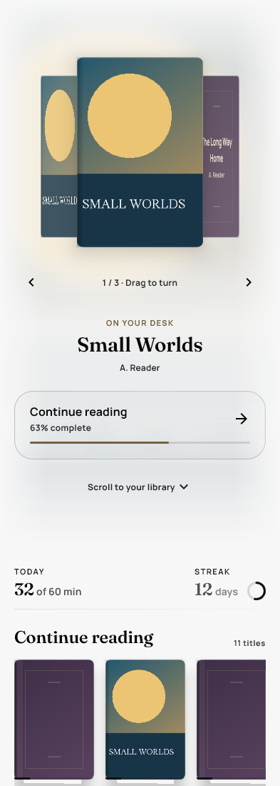
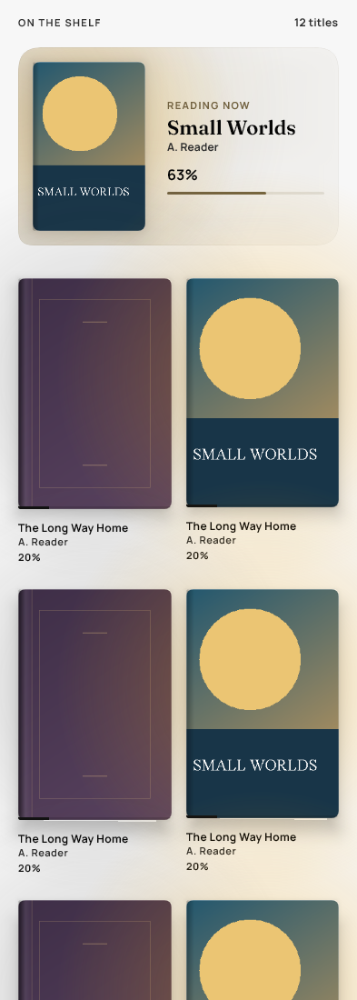
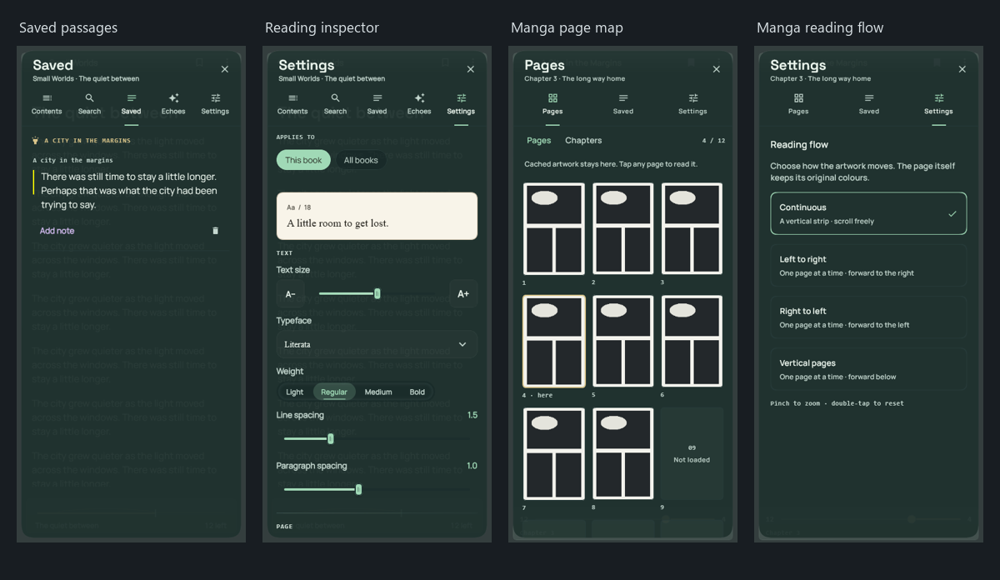

<p align="center">
  
</p>

<h1 align="center">Folio</h1>

<p align="center"><strong>A little room to get lost in a book.</strong></p>

<p align="center">
  An open-source, local-first book and manga reader for Android and Windows.<br>
  Bring your own books. Keep your place, your passages, and your reading life together.
</p>

<p align="center">
  <a href="https://github.com/Kumar-Aditya3/Folio/releases/tag/v1.2.131"><strong>Download for Android</strong></a>
  · <a href="docs/install.md">Installation & FAQ</a>
  · <a href="https://github.com/Kumar-Aditya3/Folio/releases/tag/windows-v1.0.38">Download for Windows</a>
  · <a href="https://github.com/Kumar-Aditya3/Folio/issues/new/choose">Send feedback</a>
</p>

<p align="center">
  <a href="LICENSE"></a>
  
  
  
</p>

## Your library, with room to breathe

- **Read your way.** EPUBs, documents, and local manga, with adjustable type, themes,
  highlights, notes, and bookmarks.
- **Find the passage you remember.** Search indexed book text, or download the optional
  on-device model for semantic search.
- **Keep a reading rhythm.** Daily goals, reading activity, Android widgets, and optional
  offline narration help you return to a book.
- **Start locally.** Read your imported books without an account. Library data, progress,
  highlights, and statistics are stored on your device. Cloud sync is optional and uses
  your own Firebase project.

<p align="center">
  
  &nbsp;&nbsp;
  
</p>

<p align="center"><em>Interface previews rendered from Folio's Compose UI with fictional demo books and sample activity.</em></p>



The Android APKs and portable Windows download are **early previews**.
Online manga sources, model downloads, and optional cloud sync require a connection.
See the [installation guide](docs/install.md) for download choices and known limits.

## Features

- **Books and documents.** Read EPUB 2 and 3, and import PDF, TXT, HTML, DOCX, and ODT.
  Adjust typography and layout, choose a reader theme, and save highlights, notes,
  and bookmarks. Windows offers paginated and continuous reading.
- **Manga.** Read local manga, including CBZ and ZIP archives. On Android, install
  compatible Mihon/Tachiyomi extensions for online sources, review extension trust,
  and receive background updates for followed series.
- **Library and discovery.** Organize titles with tags and collections, browse saved
  quotes, and see recommendations based on reading activity. Search indexed text
  using keyword search or the optional on-device semantic search.
- **Listening.** Android can narrate books using optional offline voice packs with
  saved listening progress. The reader also includes bundled ambient soundscapes.
- **Reading activity.** Track daily goals, streaks, sessions, and activity by content
  type. Android offers Continue Reading, Daily Rhythm, and Audiobook widgets, plus
  optional reading reminders.
- **Optional sync.** Use your own Firebase configuration to sync via Firestore REST
  with anonymous authentication. Sync metadata by default and configure a storage
  bucket if you also want to sync supported files and covers.
- **Between chapters.** A theme-aware paper bookmark sits at the left edge of the
  current cover. Open its reading space for saved passages, a reading journal,
  and three replayable games: Shelf Shift, Lantern Lines, and Book Balance.
  Games include saved runs, daily boards, practice, and personal score history.
  Find Between chapters on Home or in More.

## Platform support

| | Android | Desktop |
| --- | --- | --- |
| Status | Primary target | Windows only |
| Minimum | Android 7.0 (API 24) | Windows 10 x64 |
| Built against | compileSdk 37 | JDK 17, JVM target 17 |

Desktop is Windows-only in practice: the reader's HTML surface uses JCEF and
the build declares only `jcef-natives-windows-amd64`, while packaging targets MSI and EXE. The
desktop compilation is checked on Linux in CI, but the app will not run on Linux or macOS
without adding the matching JCEF natives.


## Project layout

```
Folio/
├── shared/                     Kotlin Multiplatform module — most of the app lives here
│   └── src/
│       ├── commonMain/         Domain models, repositories, EPUB parser, sync engine
│       ├── commonJvm/          JVM-only shared code (JDBC storage, book importer)
│       ├── composeUi/          Shared Compose UI: home, library, reader, manga, settings, stats
│       ├── androidMain/        Android platform bindings + vendored manga extension runtime
│       ├── desktopMain/        Desktop platform bindings (JCEF HTML surface, file pickers)
│       └── desktopTest/        Unit tests, run on JVM
├── androidApp/                 Android entry point, navigation shell, DI graph, settings screens
│   └── src/androidTest/        Instrumented tests
├── desktopApp/                 Compose Desktop window, MSI/EXE packaging, same DI shape
├── docs/                       Design specs, dependency plan, troubleshooting
├── firestore.rules             Security rules for the optional sync backend
└── gradle/libs.versions.toml   Single source of truth for every dependency version
```

The `shared` module sets `kotlin.mpp.applyDefaultHierarchyTemplate=false` and wires its source
sets by hand, which is why `commonJvm` and `composeUi` exist as intermediate sets shared between
Android and desktop rather than the default hierarchy's `jvmMain`.

## Getting started

### Prerequisites

- **JDK 17.** This is what CI uses and what both modules target. Newer JDKs mostly work; note
  that AGP's bundled lint crashes on JDK 25, which is why `checkReleaseBuilds = false` is set in
  `androidApp/build.gradle.kts`.
- **Android SDK** with platform 37, for Android builds only (the app targets API 34).
- No Gradle install needed — use the committed wrapper.

Point Gradle at your SDK by creating `local.properties` in the repository root (it is gitignored):

```properties
# Forward slashes avoid Java properties escaping rules on Windows.
sdk.dir=C:/Users/you/AppData/Local/Android/Sdk
```

Android Studio writes this file for you when you open the project.

### Build and run

Clone the project first (a shallow clone skips the large historical working set):

```bash
git clone --depth 1 https://github.com/Kumar-Aditya3/Folio.git
cd Folio
```

```bash
# Android debug APK -> androidApp/build/outputs/apk/debug/
./gradlew :androidApp:assembleDebug

# Install onto a connected device or running emulator
./gradlew :androidApp:installDebug

# Run the desktop app (Windows)
./gradlew :desktopApp:run

# Build a Windows installer -> desktopApp/build/compose/binaries/main/msi/
./gradlew :desktopApp:packageMsi

# Build the Windows EXE installer or the complete portable application folder
./gradlew :desktopApp:packageExe
./gradlew :desktopApp:createDistributable
```

On Windows use `gradlew.bat` in place of `./gradlew`.

The portable application is the entire `desktopApp/build/compose/binaries/main/app/Folio/`
folder. Keep `Folio.exe`, `app/` and `runtime/` together; it includes Java and does not
need a system Java installation. A relocated Gradle build directory also relocates these outputs.
Validate the packaged EXE (including its embedded icon) with
`python scripts/verify_windows_distribution.py <path-to-Folio-folder> --launch`.
Startup failures are recorded in `%LOCALAPPDATA%/Folio/folio.log`.
The Windows icons are generated from the existing launcher vector with
`python scripts/generate_brand_icons.py` (requires Pillow).

### Tests

```bash
# Shared unit tests (JUnit 5)
./gradlew :shared:desktopTest

# Instrumented Android tests — needs a connected device or emulator
./gradlew :androidApp:connectedAndroidTest
```

The instrumented suite runs against the app's real database in the app's own process and mutates
it deliberately, restoring state afterwards. Run it on a test device, not one holding a library
you care about.

## Configuration

Both configuration files below are gitignored. Committed `.example` templates document every
key, and the app runs fine with neither file present.

### Cloud sync

Optional. Create a Firebase project, enable Anonymous authentication and Firestore, then supply
the Project ID and Web API key one of three ways:

1. In the app, under **Settings → Advanced** — highest precedence, and the only way that needs no
   rebuild.
2. On desktop, in a `.env` file at the repository root. Copy `.env.example` to get started.
3. Via `FOLIO_FB_PROJECT_ID`, `FOLIO_FB_API_KEY`, and optionally `FOLIO_FB_STORAGE_BUCKET`
   environment variables, or on Android via `folio_fb_project_id` / `folio_fb_api_key` string
   resources.

Deploy `firestore.rules` to your project before syncing. The rules confine every document to the
authenticated user's own subtree, so an anonymous UID can only ever read and write its own data.

Sync stays inactive until an API key is present, so a fresh clone will not talk to any server.

### Release signing

Copy `keystore.properties.example` to `keystore.properties` and fill in your own keystore
details. Generate a keystore with:

```bash
keytool -genkeypair -v -keystore folio-release.jks -keyalg RSA -keysize 2048 -validity 10000 -alias folio
```

When `keystore.properties` is absent the release `signingConfig` is skipped entirely and debug
builds fall back to the standard debug keystore, so `assembleDebug` works on a clean clone.

## Continuous integration

`.github/workflows/ci.yml` runs on pushes to `main` and on every pull request, using JDK 17
(Temurin) on `ubuntu-latest`, split across two jobs:

- **desktop-tests** — `:shared:desktopTest` (the shared unit suite), then `:desktopApp:compileKotlin`
- **android-build** — `:androidApp:assembleDebug`

## Documentation

See the [documentation index](docs/README.md) for feature guides, platform details, and historical design notes.

## Attribution

Folio's manga support is built on code from **[Mihon]** and its predecessor **[Tachiyomi]**, both
Apache-2.0. The vendored trees under `shared/src/androidMain/kotlin/` — `eu/kanade/`, `mihon/`,
`tachiyomi/`, and `logcat/` — provide the extension runtime (loading, trust verification, install
flow) and the HTTP source engine (OkHttp interceptors, Cloudflare and rate-limit handling, source
and filter models), adapted to Folio's dependency graph. Extension compatibility means Folio can
run existing Mihon extensions; it does not host or distribute any content itself.

The `logcat` package derives from **[square/logcat]**. Injekt is consumed as a binary dependency
from Mihon's fork. See [`NOTICE`](NOTICE) for full details.

[Mihon]: https://github.com/mihonapp/mihon
[Tachiyomi]: https://github.com/tachiyomiorg/tachiyomi
[square/logcat]: https://github.com/square/logcat

## Status

An independent project in active, early development. Releases may change behavior and data
schemas; keep a backup of a library you care about. There is no fixed release cadence or
guaranteed response time. Bug reports, platform testing, and focused pull requests are welcome.

See [CONTRIBUTING.md](CONTRIBUTING.md) for ways to help. If Folio is useful to you, a GitHub
star or a link shared with another reader helps people discover it. You can watch releases
on GitHub to hear about new builds.

## License

Licensed under the Apache License, Version 2.0. See [`LICENSE`](LICENSE) and [`NOTICE`](NOTICE).

```
Copyright 2026 The Folio Authors

Licensed under the Apache License, Version 2.0 (the "License");
you may not use this file except in compliance with the License.
You may obtain a copy of the License at

    http://www.apache.org/licenses/LICENSE-2.0

Unless required by applicable law or agreed to in writing, software
distributed under the License is distributed on an "AS IS" BASIS,
WITHOUT WARRANTIES OR CONDITIONS OF ANY KIND, either express or implied.
See the License for the specific language governing permissions and
limitations under the License.
```
