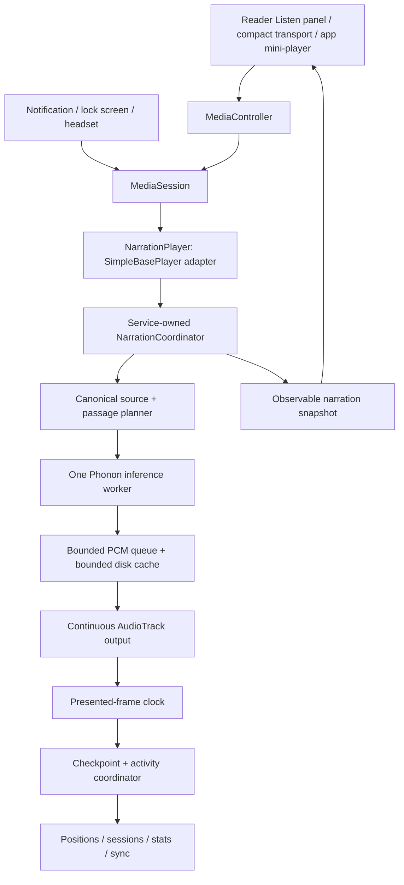

# Offline narration: Phonon 31M integration plan

Status: initial Android integration implemented; physical-device performance and the remaining compatibility/aggregation gates are pending. See [implementation notes](offline-narration.md) for the implemented contracts, verification and remaining device measurements.
Prepared 26 October 2026 against the current working tree, including its existing uncommitted changes.

## Confirmed requirements

- Phonon 31M English, local CPU inference, with an explicitly opt-in model download.
- Listening advances book progress at the corresponding text position.
- Listening counts toward the existing daily goal and streak. Confirmed by the user on 26 October.
- Reading/listening breakdowns remain available; simultaneous activity counts once in combined time.
- Playback continues with the screen off and outside the reader.
- Android media notification and lock-screen/headphone controls, in the manner of an audio player.
- UI integration must be strict and coherent with Folio's current reader, materials, motion and navigation.

## 1. Scope and release boundaries

First release: Android, English, reflowable EPUB books with accessible source text. Continuous and paged reader layouts both participate. Deliver the full path from opt-in download to background narration, text resume, statistics and coherent controls before calling the feature complete.

Use the CPU runtime first. Keep Folio's existing 32-bit app support; make neural narration unavailable on incompatible devices without loading its native library. A generic ARM64 build is the initial compatibility baseline; evaluate an optimized build separately with reliable instruction detection and device evidence. Do not globally remove ARMv7 support to accommodate this feature.

PDFs, manga OCR narration, arbitrary language switching, voice cloning, cross-device playback control, exact word-by-word highlighting and whole-book audio export are later work. Existing document/manga reading and statistics must continue to work.

The first release highlights the currently playing source passage. Phonon PCM frames do not provide trustworthy word timestamps. Exact word tracking requires separate alignment work, not text-length interpolation presented as fact.

## 2. Findings in Folio that determine the design

| Existing seam | Finding | Required change |
| --- | --- | --- |
| `ReadingSessionTracker.kt` | Reading time comes from nearby interaction events; it has an idle cutoff and a visual-reading pace guard. | Add playback evidence through a shared activity coordinator. Never simulate scroll events to earn listening time. |
| `ReaderPositionStore.kt` | ViewModel-owned, debounced scroll persistence also updates book progress and the in-memory session. | Centralize durable resume writes and explicitly transfer ownership between visual reading and narration. |
| `ReaderViewModel.closeBook()` | Ends the reader session and syncs the UI's position. | Closing a view must detach its visual activity without ending an active narration session or overwriting its checkpoint. |
| `ReadingTrace.kt` | A session produces one band from its start to end progress. | Split consumed spans at seeks; skipped text must not become a completed band. |
| `StatisticsViewModel.kt` | Totals derive from session rows; daily grouping currently uses session start date. | Introduce modality-aware aggregation and accurate day boundaries for long background sessions. |
| `FsReadingSession` / `SyncEngine` | Session and position fields have explicit local-to-cloud conversion. | Update every conversion, schema, backup and merge path; adding a Kotlin field alone does not sync it. |
| `PageEngine` / `ContinuousEngine` | Source locators and paragraph scopes are shared with native HTML hosts, including chapter shadow roots. | Reuse those scopes and introduce a tested canonical source mapping, rather than matching displayed strings by search. |
| `TextChunker.kt` | Embedding windows overlap and omit short fragments. | A separate narration planner must preserve every included word once and keep source offsets. |
| `ExperiencePlatform.android.kt` / `ReaderExperienceSession.kt` | Soundscapes own audio focus, use 44.1 kHz, and stop outside the foreground reader. | Give narration its own sample-rate-aware output and one audio-focus policy. Preserve foreground-only ambience initially. |
| `ModelDownloader.kt` | Existing on-demand download states, partial files and digest checking are embedding-specific. | Reuse proven primitives, but install a multi-file narration pack atomically. |
| `ReaderWorkspace.kt` / `FolioNavShell.kt` | Adaptive reader workspace and one shared bottom-inset contract already exist. | Integrate Listen and the mini-player through these owners; avoid another overlay/navigation stack. |

Relevant local design references: [reader direction](reader-uiux-audit-and-direction.md), [reader settings](reader-settings-sheet.md), [coherent materials](coherent-materials.md), [quiet signal](quiet-signal-implementation.md), [soundscapes](soundscapes.md), and [widgets](widgets-and-notifications.md). These describe current design/context, not additional device-operation authorization.

## 3. Runtime and opt-in pack

Research snapshot, to be validated as one compatible pair before implementation:

- Runtime repository: `gradium-ai/xn-ptts`, inspected commit `0418e21963f646e66f5b27d6c1aa5740524ec545`.
- Model: `gradium/phonon-31m-en`, inspected revision `92741c5b07d085ff840e26fea8ce43110b87852f`.
- Package version and cryptographic digests are pinned in a Folio-owned manifest; never resolve `main` at runtime.

| Initial required asset | Bytes |
| --- | ---: |
| `model.q8.gguf` | 64,512,352 |
| `tokenizer.json` | 277,967 |
| `config.json` | 4,634 |
| `default-voice.safetensors` | 256,136 |
| Total | **65,051,089 bytes: 65.1 MB / 62.0 MiB** |

Sizes are the observed upstream files, not measured RAM or APK overhead. License/notice and the manifest add a small amount. Display the sum of the actual shipped manifest in the UI. Each optional extra voice gets its own manifest, size and license check. The model card identifies these Q8 weights as Apache-2.0. [Model card](https://huggingface.co/gradium/phonon-31m-en), [file listing](https://huggingface.co/gradium/phonon-31m-en/tree/main).

Upstream provides a C library plus a blocking Kotlin/JNA wrapper and an Android build script. It is not a Gradle artifact. The default ARM64 script enables particular CPU instructions, so compile flags are part of compatibility. [Android guide](https://github.com/gradium-ai/xn-ptts/blob/main/android/README.md), [build script](https://github.com/gradium-ai/xn-ptts/blob/main/android/build.sh).

Local toolchain audit: Java and ADB resolve on PATH; `cargo`, `rustc` and `cmake` did not. Phase 0 must establish reproducible native build tooling and inspect the Android SDK/NDK installation. This is not yet a successful native build.

Download contract:

1. Initial state is Not installed. Opening settings, a book, restoring preferences or reconnecting a controller makes no model request.
2. Show `Download English narration` with actual size and a concise offline explanation. Only an explicit Download action starts retrieval; downloading does not also start playback.
3. Persist consent for that requested pack/version. Resume interrupted transfers only under the user's selected network policy; offer Wi-Fi-only. Replacement versions require a new explicit update action.
4. Use app-private, backup-excluded storage, available-space checking, cancellable transfers, bounded retries, per-file byte limits and SHA-256 verification. Range resume must validate server range behavior and version identity.
5. Stage all files in a versioned directory. Publish the installed manifest only after the complete set verifies and a model-load smoke check succeeds. Interrupted installs never appear ready.
6. Keep Cancel, Retry and Remove understandable. Removing a pack currently in use offers one concrete `Stop and remove` action; failed removal cannot claim space was freed.
7. Provide a local bundled sample if an audition is desired before download. A generated preview after installation is excluded from reading statistics.
8. Neither ordinary playback nor preview uploads book text, audio or source locations. Cloud position/statistics sync follows existing user settings. Model bytes, native binaries and generated audio never enter cloud backup.

## 4. Ownership and execution architecture

Chosen first implementation: continuous PCM `AudioTrack` output behind a Media3 `SimpleBasePlayer`, owned with its `MediaSession` by `NarrationPlaybackService`. Phonon emits short PCM frames; preserving that streaming path avoids waiting for a WAV file per sentence. The adapter must implement supported commands and publish a valid Media3 state on its application looper. It is real implementation work, not something MediaSession supplies automatically. [Custom Player contract](https://developer.android.com/media/media3/session/player).

Shared `narration` code owns source models, passage planning, checkpoint rules, activity accounting and UI state contracts. Android owns native bindings, device capabilities, audio output, media service, focus and platform controllers. Keep engine-native types out of shared UI. Desktop gets an unavailable capability initially; the existing desktop reader continues compiling and behaving normally.

- One active narration book and one inference instance per process. Commands serialize through the coordinator; UI never calls native synthesis directly.
- Separate generation and audio-output workers. Bound the queue by PCM bytes and ready-audio duration; block generation under backpressure. Start with a configurable target of 5-15 seconds ahead and a 30-second hard RAM cap, then tune from measurements.
- At 24 kHz mono, 30 seconds is 2.88 MB float PCM or 1.44 MB PCM16, excluding copies, runtime buffers and the model. Budget those separately.
- Keep inference calls bounded to mapped passages even though frames stream. Native results may retain utterance audio; do not submit a whole book in one call.
- Every start/seek/book/voice change creates an epoch. Invalidate queued audio and pending callbacks from older epochs. Stop audio promptly, request cooperative inference cancellation, join it, then close native resources.
- Pause preserves the checkpoint and freezes consumption; synthesis fills only the bounded queue. A short pause can retain the model; a longer idle timeout releases it. Relaunching an activity is not a request to resume sound.
- Stop closes the logical listening activity and releases output/model after final persistence. Process recovery restores a paused checkpoint, never unsolicited sound.

## 5. Text positions, resume and coverage

### Canonical source contract

Introduce a deterministic `NarrationDocument` built from the same chapter HTML source used by the reader, accessible without an Activity or WebView. Start with a chapter at a time. Do not depend on a populated search index: source text must work immediately after import.

Each source passage records book/content revision, chapter ID, spine index, stable paragraph identity, canonical UTF-16 start/end offsets, source locator and a content hash. Keep an explicit mapping between spoken normalization and original source positions. Whitespace collapse, entities, Unicode, pronunciation replacements, digits and abbreviations must not drift source offsets.

The renderer and narration parser must agree on paragraph ordering and excluded text. Exclude scripts/styles/navigation and explicitly hidden content under documented rules. Read headings and meaningful short paragraphs. Footnotes are not followed automatically out of reading order. Unsupported layout or ambiguous extraction reports unavailable narration rather than silently reading incorrect text. Test original CSS and normalized mode, nested elements and chapter shadow roots. Exact DOM mapping is a Phase 1 gate.

### Checkpoint contract

Track three distinct positions: source planned, audio generated, and audio presented. Only presented audio can advance consumption, book completion or listening statistics.

Persist `NarrationCheckpoint` with content revision, chapter/paragraph/source anchor, passage identity, last completed source boundary, frame offset in the current passage, model/voice identity, cache identity, epoch and updated time. Store no speculative future position as the resume location.

- A complete passage is committed only after its final audio frames pass the presentation boundary. Initial granularity is sentence/clause passages, with paragraph highlighting; book percentage can move in small passage steps.
- Sample progress within a passage is accurate for retained audio. It is not a measured word offset. If its exact PCM cache survives, resume at that frame; otherwise restart that incomplete passage and say so only when useful. Never skip the uncompleted tail.
- Use AudioTrack timestamp/playback-head evidence, including device latency, wraps, flush resets and speed changes. Written-to-buffer frames are not presented frames. This measures delivered playback, not proof of human attention. [AudioTrack reference](https://developer.android.com/reference/android/media/AudioTrack).
- Checkpoint at most every five seconds during advancing playback, and immediately on pause, explicit stop, seek, chapter boundary, focus loss and orderly service shutdown. The five-second interval is a proposed durability bound, to verify under forced process death.
- Keep these durability writes local and coalesce observer invalidation. Queue cloud checkpoints at meaningful boundaries and a separately throttled cadence; do not turn every audio frame or five-second tick into a network sync or a full-library statistics rebuild.
- Transactionally save the checkpoint, authoritative shared resume position, book percentage and corresponding activity watermark. Async completion from an old epoch or a disposed reader cannot overwrite a newer checkpoint.
- Resume uses the last consumed place, not a high-water mark. Store coverage independently; rewinding may lower resume percentage without deleting historical consumed spans.
- Completion is triggered after the final included content is presented and drained, not after synthesis finishes. Honor Folio's reading-cycle/completion policy exactly once. A seek to the end alone is not earned completion.
- Content reimport invalidates obsolete audio and attempts recovery from stable anchors/quote context. Unresolvable anchors stop with a recoverable choice; do not silently reset or skip.

### Interaction ownership

While narration owns a book's resume, the reader may maintain a separate browse viewport. Programmatic follow scrolling never emits visual activity or seeks narration.

- `Listen` with no existing session starts at the current visible source passage. `Listen from here` on selection starts at the selected source boundary and continues forward.
- Manual scrolling suspends Follow text and shows `Return to narration`. It does not interrupt audio or overwrite the narration resume. `Listen from here` is the explicit seek command.
- Opening Contents/Search only previews/browses until an explicit narration seek. Existing progress scrubbing previews a destination; its commit during narration must be clearly labelled and routed once to the coordinator.
- Pause retains narration ownership until Stop or an explicit `Continue reading here` handoff. Stop-and-read transfers the current consumed anchor to the visual reader.
- Reopening from the notification opens the playing book at the service checkpoint. Another book may be browsed, but only the foreground book receives explicit visual engagement, under the global activity union rules below.
- Close/dispose only detaches the UI. Reader shutdown cannot finalize the service's listening session or persist a stale visual position over it.

## 6. Statistics: one accounting pipeline

The user's decision is binding: listening contributes to the same daily goal, streak and heatmap. Label combined totals as Reading & listening where needed; preserve mode breakdowns and keep visual reading pace meaningful.

### Evidence and invariants

| Event | Combined active time | Content credit / position |
| --- | --- | --- |
| Audio presented while screen off | Advances by actual elapsed playback time | Advances at completed mapped source boundaries |
| 2x playback for ten wall-clock minutes | Ten minutes | Approximately twenty minutes of audio content, with actual source credit |
| Reading while narration plays | Counts that interval once | Same source exposure is not credited twice |
| Preparing/downloading/buffering/paused | No listening credit | No consumed-source advance |
| Auto-follow scroll | No extra visual time | No extra words or coverage |
| Explicit seek forward | No credit for skipped distance | Resume moves; coverage has a gap |
| Replay/backward seek | Actual replay time counts | Repeated exposure may count as listened words; unique coverage stays deduplicated |
| Voice preview / model validation sample | No book statistics | No book progress |

Use monotonic elapsed time for measurement and civil time for attribution. In each device interval, combined time is the union of valid visual engagement and advancing audio, never the sum. Define mutually exclusive `visualOnlyMs`, `listeningOnlyMs`, and `followAlongMs`; their sum is `durationMs`. Present Listening including follow-along and Reading only as an additive summary, with follow-along available in details. Do not present two overlapping totals as additive.

For different books on one device, shared time belongs once to the playing book while audio advances; visual interaction with another book is retained as activity evidence but cannot duplicate combined duration. Make this attribution visible in session detail rather than inflating the daily goal. Same-book follow-along is the explicit overlap category.

Split attribution at local midnight and timezone changes while preserving the monotonic duration. Keep a logical sitting ID so daily splits, seeks, mode transitions and checkpoints do not create artificial extra sessions. Zero-duration preparation/failed-start records do not earn a streak, active day or completed sitting. Preserve the existing activity thresholds for real earned sessions.

Concurrent records across devices must not inflate combined wall time: preserve per-device evidence, union overlapping intervals in aggregate views, and expose per-device details. Clock-skew detection and uncertain civil intervals need an explicit conservative policy; never alter measured per-device elapsed time to fit a wall-clock jump. Add fixtures for clock changes, DST and delayed sync before enabling interval-union aggregation.

Visual WPM uses visual-only words/time. Listening pace and playback speed are separate. Follow-along does not inflate visual WPM or existing reading-time-remaining estimates. Listened word exposure and unique book coverage remain separate metrics. Never reuse the visual 800-WPM guard for actual audio consumption.

### Proposed persistence and compatibility

Add versioned, bounded `ActivitySpan` records with stable IDs, logical sitting/session ID, device ID, book ID, mode, civil start/end/timezone attribution, measured duration, consumed source ranges, separate visual/listened word counts and a checkpoint watermark. Split spans on discontinuities. A crash finalizes only the last persisted watermark; recovery never invents activity for the missing interval.

Extend `ReadingSession` with optional versioned modality totals and logical sitting identity. Keep legacy `durationMs` as combined measured active time and legacy summary fields readable. Existing rows migrate as visual-only; do not reinterpret historical durations. Use source spans for new coverage/traces. Existing visual trace behavior is preserved unless an actual measured discontinuity is available.

`reading_sessions` is the compatibility summary; spans are the detailed evidence. The aggregator consumes either versioned detailed evidence or the legacy session fallback, never both. Checkpoint upserts are idempotent and transactional. Derive daily/book totals through the shared aggregation path, not increment-only counters. Use the same result for Statistics, Home, goals, streaks, Daily Rhythm widget, reminders, reading trace and journals.

Update local schema/migrations, repositories, revision emissions, JSON serializers, cloud models, `SyncEngine` conversions, REST payloads, Firestore rules and backup/export/restore together. Sync spans as independently keyed versioned records; deduplicate by ID and sequence. A legacy client rewriting a summary must not erase detailed evidence. Preserve existing sync toggles and exclusion/library-scope filters. Cross-device resume syncs a source anchor, not device-specific PCM offsets or audio files.

Mixed-version round trips are a release gate: older Android/desktop clients must retain usable summary totals and source resume, while newer clients recover modality detail without duplicate time. If existing merge behavior cannot preserve this, resolve the compatibility design before shipping instead of silently discarding detail.

## 7. Screen-off playback and Android media controls

`NarrationPlaybackService : MediaSessionService` owns playback and is independent of `MainActivity`, `ReaderScreen` and their coroutine scopes. Declare `mediaPlayback`, `FOREGROUND_SERVICE_MEDIA_PLAYBACK` and the required base permission. Start on an explicit eligible user/media action; never start audio at boot. [Background playback](https://developer.android.com/media/media3/session/background-playback), [service type rules](https://developer.android.com/develop/background-work/services/fgs/service-types#media).

- Hold a partial CPU wake lock only while active playback/generation requires it; screen stays off. Use a single idempotent resource owner with release paths on pause/stop/error/focus loss. A foreground service alone is not a CPU wake lock.
- Publish a valid Media3 Player state and session activity for deep linking. The OS renders the media card; Folio supplies metadata and commands. Notification shape, color and action placement vary by Android/OEM, so matching Spotify means familiar media behavior rather than pixel identity.
- Display book cover, book title, chapter title, author, play/pause and previous/next passage controls. Expanded controls include Stop when supported; headphone next/previous uses the same source-passage commands. The current chapter is the media item, never each tiny PCM frame.
- First release uses passage skip semantics, labelled identically in the app and accessibility descriptions. Do not label passage skips as 15-second seeks. Optional timed skips can follow once accurate cached timeline mapping exists.
- Chapter duration is unknown before enough audio has been generated. Publish unknown duration and disable unsupported seek commands; retain the source-based book progress control in Folio. Do not publish fabricated chapter durations or book percentages as audio milliseconds. Fully cached chapters may expose verified time seeking later.
- Separate persistent `playWhenReady` intent from buffering and advancing output. Ended waits for the audible tail to drain. Updating metadata or opening a controller must not restart playback.
- Handle focus denial, transient/permanent loss, phone calls, Bluetooth route changes and unplug events. Pause spoken content on interruptions instead of ducking speech underneath it. Automatic resumption is allowed only for a matching transient interruption when prior user intent still permits it; never after a user pause, unplug, permanent focus loss or cold process recovery. [Audio focus](https://developer.android.com/media/optimize/audio-focus).
- Narration owns focus while active. Existing soundscapes pause for narration in the initial release; the UI explains this when relevant. Background ambience mixing would require deliberate service ownership and resampling work later.
- Provide an elapsed-time sleep timer and end-of-chapter timer. Pause at expiry, persist, and release the wake lock. Timer uses monotonic deadlines; no exact-alarm permission. End-of-chapter waits for the last presented frame.
- Swiping the app from recents continues active playback. Explicit Stop removes the active media item/notification and releases resources. Paused notification/service retention follows the platform lifecycle; the durable checkpoint survives independently.
- Proper media-session notifications have a notification-permission exemption; do not block narration behind Folio's reminder-notification opt-in. Test denied notification permission and manufacturer behavior. [Notification exemptions](https://developer.android.com/develop/ui/compose/notifications/notification-permission#exemptions).
- A force-stop or OS kill can stop sound. Recover paused at the durable checkpoint on the next eligible user action; never promise uninterrupted playback after force-stop.

## 8. Strict UI integration contract

### Stable entry points and layout

| Surface | Required integration |
| --- | --- |
| Reader tools | Add `Listen` within the existing adaptive workspace. Its panel is the single full control surface; tab overflow remains usable at narrow widths/large type. |
| Reader selection | Add `Listen from here` beside existing contextual actions, retaining the exact chapter/source anchor. Do not create a second floating selection/player stack. |
| Reader compact transport | Extend the existing bottom reading instrument while narration is active. Show play/pause, source passage navigation and current chapter; expand into Listen. Hide the compact transport while its full panel is open. |
| App outside the reader | One app-level mini-player above the existing navigation capsule; publish its additional height through the shared bottom-inset seam. Hide it when the same book's reader transport is visible. |
| Settings | One Narration section for pack management and global voice/speed defaults; keep download installation state global. Reader controls edit the active session, with scope labels for any persisted preference. |
| Statistics / Home / widget | Use existing layouts and one shared aggregation result. Add reading/listening detail, keeping the overall goal and streak coherent. |
| Notification | System media card from the same Player state, with cover/title/chapter, familiar transport and a deep link to the listening anchor. |

Opening the Listen panel does not start sound. Downloading a pack does not start sound. Starting a second book is one explicit action that stops/flushes the first before replacing it; the UI names the affected book. Browsing a second book does not silently switch narration.

Reader browse progress and narration progress must not compete in one unlabeled scrubber. While browsing away, show a concise `Narration: Chapter ...` / `Return to narration` affordance; label a committed narration seek as such. Back dismisses the current sheet before leaving the reader, and never means Stop. Stop is an explicit labelled command.

### Visual and interaction rules

- Use `FolioTheme`, existing typography, `FolioTokens`, shared shapes, reader islands, `folioReaderGlass`, settings/data-glass seams, icon family and the resolved motion table. No standalone player palette, hardcoded cyan/green, nested glass cards or new backdrop-capture system.
- Reader controls honor reader opacity; global mini-player/settings honor app material preferences. At 100% opacity the surface is solid. Sheen off, minimal glass, no blur and reduced motion retain all state and legibility.
- Preserve a quiet page: no perpetual equalizer, waveform or atmospheric animation tied to narration. State is conveyed with labels, progress and finite transitions. No rendering clock runs while screen off.
- Transport order, labels, disabled states and skip semantics match across compact transport, expanded panel, mini-player and notification as far as the OS permits. Each invokes the same command; none owns a second playback boolean or timer.
- Publish loading/command acknowledgement promptly. During preparation and buffering show `Preparing narration` or `Buffering` with a working Pause/Stop action. Errors remain inline with an actionable Retry; a toast is not the sole failure indication.
- Meet 48dp touch targets, TalkBack labels/states, logical focus order, keyboard navigation and supported text scaling. At 320dp and 200% text, controls may reflow/scroll without obscuring source text or navigation.
- Narration highlight is transient, distinct from saved annotations, and follows the selected book theme. Auto-follow is opt-in per active listening session, yields immediately to touch/selection, and works in continuous/paged layouts. A follow jump is never a user-reading event.
- Model/runtime terms such as Q8, GGUF, native kernels and thread counts stay in diagnostics. Product labels use `English narration`, `Download`, `Voice`, `Speed`, `Follow text`, `Sleep timer` and concrete states.

### Required state coverage

Pack states: Unsupported, Not installed, Downloading, Verifying, Installed, Failed, Removing.

Playback states: Idle, Preparing, Buffering, Playing, Paused, Seeking, Interrupted, Ended, Error. Model installation and playback are separate state machines. Download failure cannot look like playback pause; selecting a preview cannot look like a book session.

Every state must have a defined title, primary action, secondary action, progress behavior, accessibility announcement and exit path before implementation of its UI is accepted. Controls survive reconnection without flashing a false Playing state or duplicating commands.

## 9. Phases and exit gates

| Phase | Work | Required evidence before advancing |
| --- | --- | --- |
| 0. Native feasibility | Reproducible pinned CPU build, generic ARM64 loading, wrapper lifecycle/cancellation, 16 KB ELF alignment and release/R8 packaging. Measure actual APK overhead and the complete pack load. | Valid native library, successful synthesis and stop/reload on a suitable test surface; phone evidence is ultimately required for performance claims. No speculative fast-start claims. |
| 1. Source and data contracts | Canonical text mapping, checkpoint/ownership protocol, source spans, stats schema, compatibility migration and state/action tables. | Source boundaries round-trip through paged/continuous rendering; no missing/duplicated text; fixtures prove seek/coverage and migration behavior. |
| 2. Playback core | Single worker/queue/output, Player adapter, cancellation epochs, durable presented-frame checkpoints, speed behavior. | Deterministic clock tests; no position/stats advancement from prefetched or queued audio; no obsolete audio after seek. |
| 3. Android lifecycle | Media service, foreground notification, focus/noisy routing, wake lock, deep link and sleep timer. | Screen-off, rotation/navigation, controller reconnection and interruption matrix passes; resources release on every exit. |
| 4. Product integration | Opt-in pack UI, reader Listen workspace, selection start, compact transport, global mini-player, follow text and progress ownership. | Actual Folio surfaces render coherently across required states, themes, widths, text scaling and effects settings; no competing progress controls or obscured content. |
| 5. Accounting and sync | Shared visual/audio union, goals/streaks/Home/widget/trace integration, cloud/backup round trips. | All consumers agree on the same totals; no double credit; midnight/sync/replay/seek fixtures and mixed-client compatibility pass. |
| 6. Sustained validation | Real book listening, CPU/RAM/battery/thermal measurements, long foreground/background runs and release packaging. | Playback remains usable on the supported phone class; findings and any capability limits are documented. Only then choose default speed/buffer/cache budgets and ship. |

Do not ship a player-only milestone as the finished feature. UI, persistence and statistics contracts are designed in Phase 1 and implemented/tested alongside their owning phases; Phase 5 is the end-to-end accounting gate, not the first time stats are considered.

## 10. Validation matrix and instrumentation

| Area | Cases that must pass |
| --- | --- |
| Consent/installation | No network before opt-in; cancel/retry/process death; range-resume rejection; truncated/corrupt file; insufficient space; atomic install; remove while paused/playing; no silent pack upgrades. |
| Source mapping | Short headings, abbreviations, dialogue, numbers, entities, emoji/surrogate pairs, repeated text, nested inline tags, footnotes, hidden nodes, chapter shadow roots, source reimport and unsupported layout. |
| Audio/checkpoints | Long sentences; 0.75x/1x/1.5x/2x where supported; pause in a passage; generation ahead of playback; seek during callback; tail drain; partial AudioTrack writes; underrun; timestamp fallback/wrap/flush reset; old epoch completion. |
| Progress/coverage | Resume equals consumed source; browse viewport cannot clobber it; no skipped span credit; end-of-book exactly once; cached precise resume and cache-miss passage restart; content hash mismatch. |
| Statistics | Ten minutes at 2x remains ten goal minutes; overlapping visual/audio activity counts once; another book/device overlap; buffering/pause/preview earn zero; explicit replay versus unique coverage; midnight/timezone change; crash flush idempotence. |
| Android lifecycle | Screen off for 30+ minutes; navigate away; rotate/recreate Activity; recents swipe; force-stop/relaunch; phone-call interruption; wired unplug; Bluetooth loss/reconnect; focus denial; notification permission denied; lock-screen action with no Activity; user pause racing focus regain. |
| UI | Not-installed/downloading/error/preparing/playing/paused/ended states; reader and app mini-player transitions; selection and keyboard coexistence; long title/missing cover; 320dp/393dp/tablet, portrait/landscape, 100/140/200% text, RTL shell; light/dark/custom themes, opaque/minimal/no-blur/reduced-motion modes. |
| Sync/backup | Old data defaults to visual; every new field round-trips; two devices/duplicate delivery/retries; legacy summary rewrite preserves detailed evidence; exclusions and library scope; backup excludes assets/cache; book deletion stops matching playback and cleans checkpoints. |

Instrument locally: cold model load and warm time-to-first-audio, RTF with p50/p95 per passage length, ready-buffer seconds, underruns/audible stalls, playback speed, peak process/native memory, CPU use, temperature/thermal throttling, battery per listening hour, native-library/APK bytes, pack/cache disk bytes, checkpoint age and resume deviation.

Performance targets are acceptance proposals, not measurements: aim for warm first audio under 500ms and comfortably sustained output at the selected playback speed, with zero unexplained stalls in a representative 30-minute run. A useful initial throughput target is generation using at most 70% of the time available at the selected speed; report thermal degradation and worst passages, not only an average. If a phone cannot sustain the selected speed, explain the limit and offer a lower speed. Preparing chapters offline is a later alternative, with a separate bounded-cache policy.

Run meaningful shared unit tests for accounting/mapping/state transitions, repository migration/sync tests and Android tests for native/service/audio behavior. Use actual Compose and native notification renders for visual QA; static wireframes alone are insufficient. Test release/R8 builds and both supported and unsupported ABI behavior. No broad unrelated test sweeps or device installs are implied by this planning pass.

## 11. Decisions still requiring evidence

- Native library size, RAM, startup/throughput, Windows-host build route and minimum working Android API are unmeasured. Generic versus optimized CPU tradeoffs require device validation.
- The minimum supported phone class and primary benchmark device must be identified before defining performance-based availability. An emulator cannot qualify phone battery, heat or screen-off reliability.
- Validate the pinned model/runtime compatibility and actual default voice before building the pack manifest. Determine whether a preferred voice should replace the default after a listening comparison.
- Confirm source-to-DOM parity on Folio's real EPUB corpus before promising text-follow precision.
- Validate the custom Media3 Player's command availability/notification behavior across Android versions and OEMs. Unknown duration and passage skips are deliberate initial limitations.
- Finalize exact schema/migration names and mixed-version merge preservation before persistence implementation. The statistics invariants above are fixed requirements.
- Phone availability and permission for implementation-time device testing are separate from this plan. No live phone was accessed here.

Implementation should begin with Phase 0 and the Phase 1 contracts. Nothing in this plan authorizes replacing existing user work, silently installing a model, or declaring untested performance.
